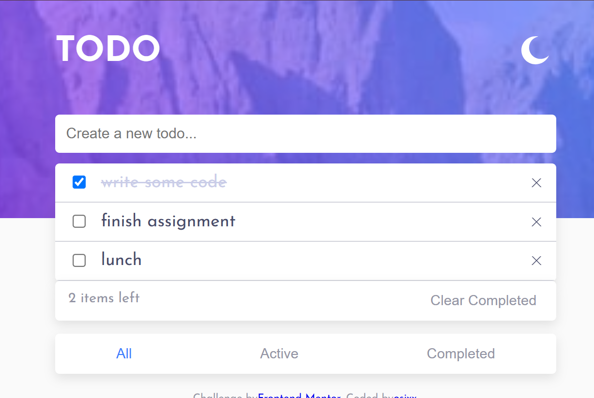

# Todo App

A todo app built with vanilla HTML, CSS and JavaScript, based on the [Frontend Mentor Todo app challenge](https://www.frontendmentor.io/challenges/todo-app-Su1_KokOW). I built it to practise JavaScript and DOM fundamentals without a framework.

## Features

- Add a todo by typing and pressing Enter
- Mark todos as complete or active
- Delete individual todos
- Filter by All, Active or Completed
- Clear all completed todos at once
- See how many items are left (singular and plural handled)
- Todos are saved in `localStorage`, so they survive a page refresh
- Light and dark themes, driven by CSS custom properties
- Mobile-first layout

## Built with

- Semantic HTML5
- CSS custom properties, Flexbox and a mobile-first approach
- Vanilla JavaScript (ES6+)
- `localStorage` for persistence

## How it works

- The todos array is the single source of truth. Each todo is an object with `text`, `id` and `completed`.
- A `renderTodos()` function redraws the list from that array, and every change ends by calling it.
- One delegated `change` listener and one delegated `click` listener on the list handle toggling and deleting, including for todos created after the page loads.
- A `currentFilter` variable decides which todos are shown and which filter button is highlighted.`

- 

## What I learned

CSS specificity decides which rule wins: my `.selected:hover` rule was ignored even though it came last in the file, because `.bottom-nav button:hover` scored higher. I fixed it by adding `button:not(.selected):hover` on the `.bottom-nav`

Event delegation, which entails putting an event listener on a parent like the `ul`, means the `li`s themselves don't need their individual listeners. The browser bubbles the click up to the parent, and then the `closest()` method finds which todo was clicked.

Better debugging with DevTools

## Running it locally

1. Clone the repo:
   ```bash
   git clone <your repo URL>
   ```
2. Open the folder in VS Code.
3. Start it with the Live Server extension, or just open `index.html` in a browser.

No build step or dependencies are needed.

## Planned improvements

- Remember the chosen theme between visits
- Desktop layout and desktop background images
- `aria-pressed` on the filter buttons for screen readers
- Handle corrupted `localStorage` data with `try/catch`

## Author

**osixx**

## Acknowledgements

Design and challenge brief by [Frontend Mentor](https://www.frontendmentor.io?ref=challenge).
